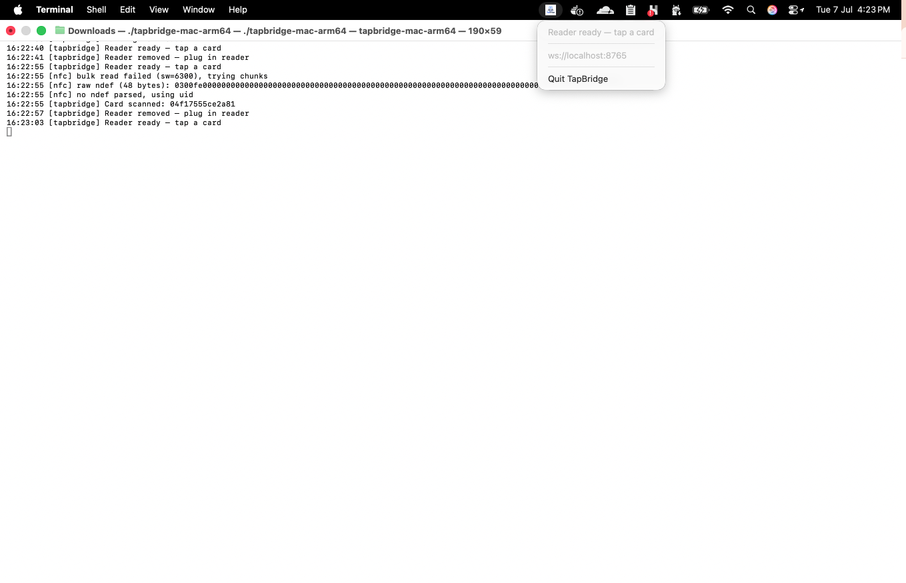
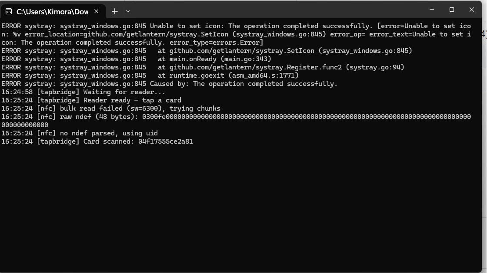

<div align="center">


# TapBridge

**Use a USB NFC reader from any web page.**

A tiny tray app that streams NFC card taps from a PC/SC reader (like the ACR122U) to your browser over a local WebSocket, and writes tags on request.

[](https://github.com/felaris/tapbridge/actions/workflows/test.yml)
[](https://github.com/felaris/tapbridge/actions/workflows/release.yml)
[](https://github.com/felaris/tapbridge/releases/latest)
[](https://hub.docker.com/r/felaris/tapbridge)
[](go.mod)
[](LICENSE)

[Download](#install) · [Quick start](#quick-start) · [Protocol](docs/protocol.md) · [Troubleshooting](docs/troubleshooting.md) · [FAQ](docs/faq.md)

</div>

---

```js
const ws = new WebSocket("ws://localhost:8765");
ws.onmessage = (e) => {
  const msg = JSON.parse(e.data);
  if (msg.type === "card") console.log("Tapped:", msg.id);
};
```

That's the whole integration. No browser extension, no native messaging, and it works in every browser.

| macOS | Windows |
|:---:|:---:|
|  |  |

## Why

Browsers can't talk to USB smart-card readers. Web NFC is Android-only,
Web Serial doesn't speak PC/SC, and WebUSB is blocked from smart-card
readers ([details](docs/faq.md#why-not-web-serial-or-webusb)). TapBridge
fills that gap with a small local app.

## Features

- **Read taps in any browser.** Each tap delivers the tag's NDEF Text/URI value, or the card's UID.
- **Write tags.** Write a Text or URI record to NTAG/Ultralight tags from your page.
- **Readable errors.** Every failure comes with a plain-English message that says what to do, plus a stable `code` ([list](docs/protocol.md#error-codes)).
- **Secure by default.** Listens on this computer only and accepts only `localhost` pages unless you allow other origins.
- **Resilient.** It survives reader unplug/replug, Windows Smart Card service restarts and Plug-and-Play hiccups, and it auto-selects the right slot on dual-slot readers.
- **Tray app.** Shows live status, lets you pick a reader, and has *Start at Login* and *Open Log File*.
- **Single binary.** Built in Go, with no runtime dependencies.

## Install

| Platform | Download |
|---|---|
| **Windows 10/11** (64-bit) | [`tapbridge-windows.exe`](https://github.com/felaris/tapbridge/releases/latest/download/tapbridge-windows.exe) |
| **macOS** Apple Silicon | [`tapbridge-mac-arm64`](https://github.com/felaris/tapbridge/releases/latest/download/tapbridge-mac-arm64) |
| **macOS** Intel | [`tapbridge-mac-intel`](https://github.com/felaris/tapbridge/releases/latest/download/tapbridge-mac-intel) |
| **Linux** (amd64, arm64 / Raspberry Pi) | Docker: `docker pull felaris/tapbridge` ([guide](docs/docker.md)) |
| Other | [Build from source](#build-from-source) |

**Windows:** run the `.exe`. TapBridge isn't code-signed yet, so SmartScreen
may warn: choose **More info → Run anyway**. It runs in the notification
area (click **^** by the clock). There's no console window.

**macOS:** use the one-line installer, which also clears Gatekeeper's quarantine flag:

```bash
curl -fsSL https://github.com/felaris/tapbridge/releases/latest/download/install.sh | bash
```

**Linux (Docker):**

```bash
docker run -d --name tapbridge --restart unless-stopped --device /dev/bus/usb -p 127.0.0.1:8765:8765 felaris/tapbridge
```

Docker is for Linux hosts. On macOS and Windows, Docker can't easily reach USB readers, so use the native apps there ([why](docs/docker.md#where-docker-makes-sense)).

You'll also need the PC/SC driver for your reader if the OS doesn't include
one (for the ACR122U on Windows: ACS's *PC/SC Driver*).

## Quick start

1. Plug in your reader and start TapBridge. The tray shows **Reader ready — tap a card**.
2. Serve the demo page from localhost and open it:
   ```bash
   cd examples/browser && python3 -m http.server 8000
   ```
   Then browse to <http://localhost:8000>.
3. Tap a card.

Is your page served from somewhere other than `localhost`? Allow its origin:

```bash
tapbridge --allow-origin https://app.example.com
```

If you forget, the page receives an error that tells you exactly this.

## Protocol at a glance

| Direction | Message |
|---|---|
| → you | `{"type":"ready"}` on connect |
| → you | `{"type":"card","id":"abc123"}` on every tap |
| you → | `{"type":"write","id":"abc123","recordType":"text"}` to write the next tapped card |
| → you | `{"type":"write_ok","id":"abc123"}` or `{"type":"write_error","code":"tag_too_small","message":"This tag is too small for that value: …"}` |

Full reference: [docs/protocol.md](docs/protocol.md).

## Documentation

| | |
|---|---|
| [Protocol](docs/protocol.md) | Messages, error codes, examples |
| [Configuration](docs/configuration.md) | Flags, environment variables, allowed origins, config and log files |
| [Troubleshooting](docs/troubleshooting.md) | Windows, macOS, browser and tag problems |
| [Docker](docs/docker.md) | Running headless on Linux / Raspberry Pi |
| [Hardware](docs/hardware.md) | Supported readers and tags |
| [FAQ](docs/faq.md) | Web NFC / Web Serial / WebUSB, security, multi-client |
| [Architecture](docs/architecture.md) | How the code is organised |

## Build from source

Requires Go (see [`go.mod`](go.mod) for the version). On macOS and Linux it also needs cgo; on Linux, the PC/SC and GTK headers:

```bash
sudo apt-get install -y libpcsclite-dev libgtk-3-dev libayatana-appindicator3-dev  # Debian/Ubuntu only
```

```bash
git clone https://github.com/felaris/tapbridge.git
```

```bash
cd tapbridge && make build && ./tapbridge
```

Run `make help` to see all tasks (`make check` runs everything CI runs, and `make windows` cross-compiles the Windows app).

## Contributing

Bug reports, reader compatibility reports and PRs are welcome. See
[CONTRIBUTING.md](CONTRIBUTING.md). For security issues, see [SECURITY.md](SECURITY.md).

## License

[MIT](LICENSE)
